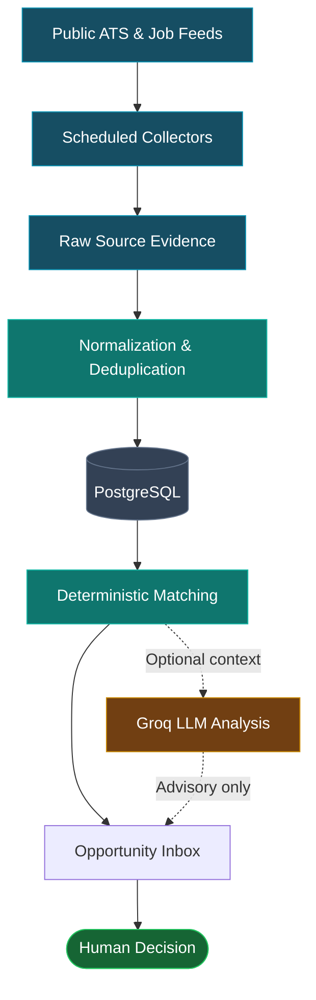
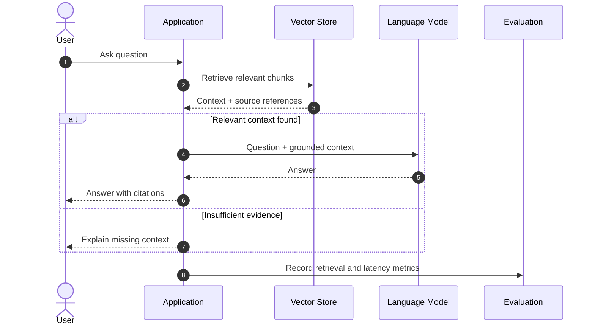
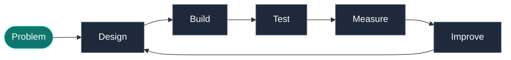

<div align="center">


# Hey, I'm Matheus Francisco 👋

### Software Engineer · Applied AI · Backend & Full Stack


<br/>

[](https://portifolio-ia-nine.vercel.app/)
[](https://www.linkedin.com/in/matheus-francisco0/)
[](https://portifolio-ia-nine.vercel.app/cv.pdf)
[](mailto:math.francisco2@gmail.com)

<br/>

`🇧🇷 Brazil (UTC-3)` · `🌍 Remote opportunities` · `🇺🇸 Fluent English`

</div>

---

## 👨‍💻 A little about me

I'm a **Software Engineer working at the intersection of backend engineering, full-stack products and Applied AI**.

My professional experience spans enterprise payment systems, distributed backend services, web and mobile applications, and production conversational AI platforms.

I work primarily with **Java, Spring Boot, Python, TypeScript, React and NestJS**, building software that needs to be reliable beyond the happy path.

When working with AI, I focus on the engineering around the model:

- **Data & retrieval:** ingestion, indexing, RAG and source-grounded responses.
- **Agents & integrations:** tool calling, APIs, orchestration and business rules.
- **Reliability:** fallbacks, guardrails, error handling and observability.
- **Quality:** automated tests, evaluation, latency and measurable behavior.
- **Architecture:** clear boundaries, pragmatic design and maintainability.

> **My engineering philosophy:** An LLM is one component of a system. Reliability comes from everything we build around it.

---

## 🚀 Featured engineering projects

A selection of projects demonstrating how I design systems, make technical decisions and turn ideas into working software.

### 01 · Opportunity Radar — AI-assisted job intelligence

**Local-first platform for collecting, normalizing and evaluating professional opportunities.**

[](https://github.com/mathfrancisco/Opportunity-Radar)
[](https://github.com/mathfrancisco/Opportunity-Radar/blob/main/docs/47-arquitetura-atual.md)

`Python` `FastAPI` `PostgreSQL` `React` `Docker` `Groq` `GitHub Actions`

Opportunity Radar transforms public, permitted job sources into a structured decision-support system.

**Engineering highlights**

- Scheduled collection from supported public ATS and feeds.
- Raw source evidence and canonical opportunity normalization.
- Deduplication and deterministic eligibility scoring.
- Optional LLM analysis that explains results without overriding business rules.
- React dashboard with opportunity tracking and human-controlled decisions.
- Containerized development environment and automated quality checks.

**What makes it different:** The system does not blindly trust AI-generated judgments. Eligibility is deterministic, source evidence is preserved and the final decision remains with the user.

<details open>
<summary><strong>🧩 Architecture — From raw sources to decisions</strong></summary>

<br/>



**Key architectural decision**

AI generates commentary and explanations, not eligibility verdicts. This keeps matching predictable, auditable and independent of model availability.

[Read the system architecture →](https://github.com/mathfrancisco/Opportunity-Radar/blob/main/docs/47-arquitetura-atual.md)

</details>

### 02 · AI Library Platform — Java + Spring AI

**Intelligent digital library with hybrid retrieval, document understanding and AI assistance.**

[](https://github.com/mathfrancisco/ai-library-plataform-mvp)

`Java 21` `Spring Boot` `Spring AI` `PostgreSQL` `pgvector` `Next.js` `React`

A modular full-stack product integrating traditional application development with modern AI capabilities.

**Engineering highlights**

- Catalog federation and structured book metadata.
- Hybrid retrieval combining full-text and vector similarity.
- Document ingestion and source-grounded RAG.
- Tenant-scoped retrieval to protect private data.
- AI-assisted discovery, summaries and recommendations.
- Tool-enabled assistance with access boundaries.
- Modular application architecture and documented engineering decisions.

**What makes it different:** Rather than creating a basic chatbot wrapper, this project explores how AI fits into a complete Java software product.

### 03 · Personal RAG Assistant — Local-first AI

**Document question-answering with citations, local models and measurable retrieval quality.**

[](https://github.com/mathfrancisco/Personal-RAG-Assistant)

`Python` `LangChain` `ChromaDB` `Ollama` `Streamlit` `pytest`

**Engineering highlights**

- Multi-format document ingestion.
- Local-first execution without mandatory cloud API calls.
- Source citations for generated answers.
- Incremental indexing based on file changes.
- Provider abstraction for model flexibility.
- Retrieval evaluation with Recall@k.
- Latency measurement and optional tracing.

**What makes it different:** Retrieval quality and transparency are treated as engineering requirements, not afterthoughts.

<details>
<summary><strong>🔬 How a grounded RAG system works</strong></summary>

<br/>



**Engineering principle:** A confident answer is not necessarily a correct answer. Retrieval quality, source traceability and evaluation matter.

</details>

### 04 · URL Shortener — Full-stack Java

**URL management platform with authentication, analytics and a modern web interface.**

[](https://github.com/mathfrancisco/URL-Shortener)

`Java` `Spring Boot` `Spring Security` `MongoDB` `React` `TypeScript`

A complete full-stack application exploring REST APIs, user management, authentication, persistence and analytics.

### 05 · LiveChat — Real-time communication

**Real-time messaging using WebSocket-based client/server communication.**

[](https://github.com/mathfrancisco/LiveChat-App)

`Java` `Spring Boot` `WebSocket` `STOMP` `Angular`

An exploration of real-time messaging, event-driven features and frontend/backend integration.

<div align="center">

<br/>

[](https://github.com/mathfrancisco?tab=repositories)

</div>

---

## 🧠 How I approach AI Engineering

I believe production AI is a **software engineering discipline**, not just a model integration problem.

| Engineering principle | My approach |
| --- | --- |
| 🎯 **Grounded responses** | Retrieval pipelines, source references and clear evidence boundaries. |
| 🛡️ **Human control** | Deterministic rules and advisory-only AI for critical decisions. |
| 📊 **Measurable quality** | Evaluation datasets, retrieval metrics and latency analysis. |
| 🔄 **Resilience** | Provider abstraction, graceful degradation and controlled fallbacks. |
| 🔐 **Security** | Data isolation, authorization and controlled tool execution. |
| 🏗️ **Pragmatic design** | Modular systems with clear responsibilities and limited complexity. |

### The engineering loop



*Good systems evolve through feedback, not assumptions.*

---

## 💼 Engineering in production

### CI&T — Software Engineer

Working on enterprise payment products across backend services, integrations and web/mobile applications.

**Technical contributions**

- Java/Spring Boot microservices and enterprise API integrations.
- NestJS BFF services with REST and GraphQL.
- React, React Native, Next.js and TypeScript applications.
- API contract design, OpenAPI and security validation.
- Azure AD and role-based access control.
- Automated testing, code reviews, CI/CD and observability.
- Production monitoring using tools such as Datadog.

### Conversational AI & Automation

Professional experience developing AI-enabled communication and credit-recovery systems.

Working across:

- Python/FastAPI services and business integrations.
- LLM-based conversational workflows.
- Retrieval-augmented generation and guardrails.
- WhatsApp and SMS communication.
- PostgreSQL and tenant-aware data handling.
- Monitoring, performance tuning and failure recovery.

### Selected engineering outcomes

<table>
<tr>
<td width="33%" align="center">

### 100K+

**Daily users**

Contributed to production web and mobile systems serving a large user base.

</td>
<td width="33%" align="center">

### 90%

**Backend test coverage**

Worked on automated testing and quality improvements.

</td>
<td width="33%" align="center">

### −25%

**Production incidents**

Contributed to reliability improvements in professional engineering work.

</td>
</tr>
</table>

<sub>Selected outcomes from professional projects; figures reflect specific systems and team efforts, not benchmarks of the public repositories.</sub>

---

## 🛠️ My engineering toolkit

<div align="center">

### Backend & APIs


### Frontend & Mobile


### AI & Data


### Cloud, DevOps & Quality


</div>

<details>
<summary><strong>Additional engineering concepts & practices</strong></summary>

<br/>

`Distributed Systems` · `Microservices` · `Modular Monoliths` · `REST APIs` · `GraphQL` · `BFF` · `DDD` · `Clean Architecture` · `SOLID` · `Automated Testing` · `CI/CD` · `Observability` · `RAG Evaluation` · `Tool Calling` · `API Security` · `Performance Optimization`

</details>

---

## 🎓 Education & certifications

**Education**

- **B.Sc. in Artificial Intelligence** — UNIVESP, in progress.
- **Systems Analysis and Development** — UNIFEOB, expected December 2026.
- **Technical education in Electronics.**

**Professional certifications**

- Claude Certified Developer — Foundations
- Oracle Agentic AI Foundations Associate
- Oracle AI Database Certified Foundations Associate

---

## 📈 GitHub activity

<div align="center">


</div>

---

## ☕ Beyond the code

<details>
<summary><strong>Open my developer terminal</strong></summary>

<br/>

```text
$ whoami
> Software Engineer building reliable products and applied AI.

$ cat engineering-principles.txt
> Understand the problem before choosing the technology.
> Keep business rules explicit.
> Measure before optimizing.
> Design for failure, not just success.
> Make the system observable.
> Prefer maintainability over unnecessary complexity.

$ echo $CURRENT_INTERESTS
> AI Agents | RAG | System Design | Backend Architecture

$ git status
> Always learning. Always improving.

$ ./ship.sh
> Build thoughtfully. Test thoroughly. Ship responsibly. 🚀
```

</details>

---

## 🤝 Let's build something meaningful

I'm open to remote opportunities involving:

**AI Engineering · Backend Development · Full-Stack Engineering · Applied LLM Systems**

I enjoy working on products that combine solid software fundamentals, thoughtful architecture and practical AI capabilities.

<div align="center">

[](https://portifolio-ia-nine.vercel.app/)
[](https://www.linkedin.com/in/matheus-francisco0/)
[](mailto:math.francisco2@gmail.com)

<br/>

**Reliable systems. Useful AI. Thoughtful engineering.**


</div>
