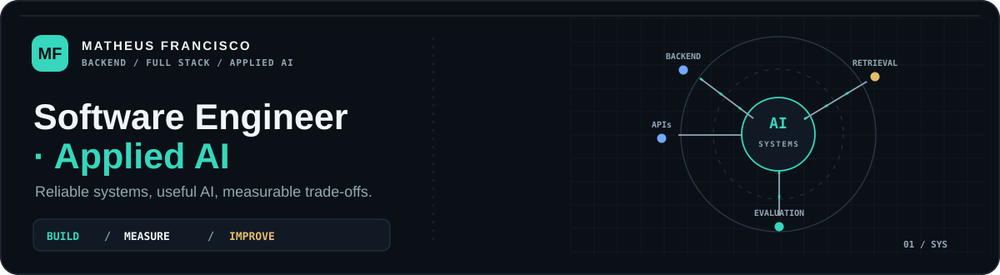
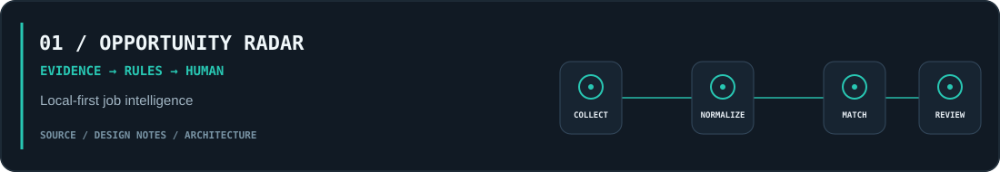
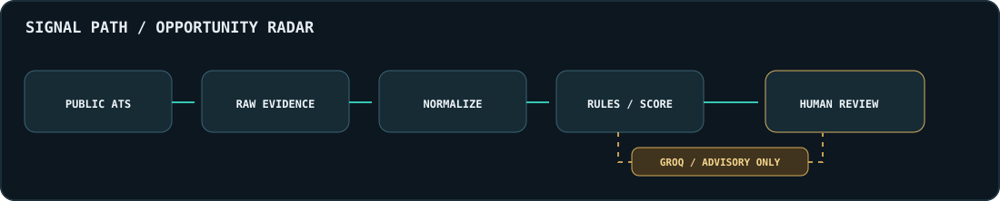
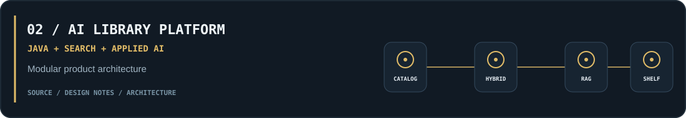
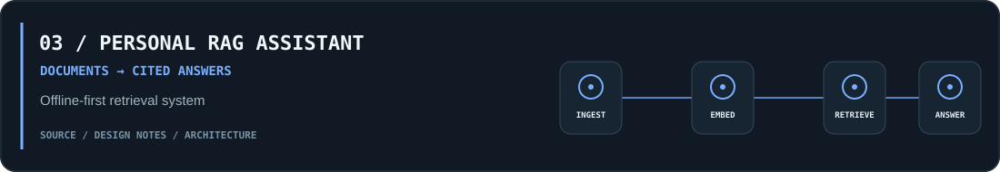

<div align="center">

<picture>
  <source media="(prefers-color-scheme: dark)" srcset="assets/hero-dark.svg">
  <source media="(prefers-color-scheme: light)" srcset="assets/hero-light.svg">
  
</picture>

**Backend & full-stack engineering · Applied AI**

[Portfolio](https://portifolio-ia-nine.vercel.app/) · [LinkedIn](https://www.linkedin.com/in/matheus-francisco0/) · [Projects](https://github.com/mathfrancisco?tab=repositories) · [Email](mailto:math.francisco2@gmail.com)

`Brazil · UTC−3` &nbsp; `Remote collaboration` &nbsp; `English / Portuguese`

</div>

### Hi, I'm Matheus.

I build **reliable backend, full-stack and applied-AI systems**, from domain modeling and APIs to interfaces, deployment and production support. My work spans enterprise payments at **CI&T** and conversational AI for financial operations.

I'm especially interested in the hard part *around* the model: **source quality, constraints, evaluation, security, latency and graceful failure**.

> **My rule of thumb:** keep decisions explainable, make failure visible, and measure what matters.

## Selected work

### 01 / [Opportunity Radar](https://github.com/mathfrancisco/Opportunity-Radar) — Evidence-first job intelligence

[](https://github.com/mathfrancisco/Opportunity-Radar)

A local-first system that collects permitted public job sources, preserves evidence, normalizes vacancies and supports application decisions.

**Built with:** Python · FastAPI · APScheduler · PostgreSQL · React · Docker Compose · Groq (opt-in).

**The decision:** eligibility and scoring stay **deterministic**. The LLM supplies *advisory explanations*, never the final verdict. Source evidence remains traceable; the human controls applications. The architecture is a **modular monolith**, not microservices, and does **not** use Ollama for current matching.

[Current architecture](https://github.com/mathfrancisco/Opportunity-Radar/blob/main/docs/47-arquitetura-atual.md) · [Source](https://github.com/mathfrancisco/Opportunity-Radar)

<details>
<summary><b>Inspect the decision flow</b></summary>



The optional AI branch is intentionally separate from the deterministic evaluation. [Full technical diagram](docs/ARCHITECTURES.md#01--opportunity-radar).

</details>

### 02 / [AI Library Platform](https://github.com/mathfrancisco/ai-library-plataform-mvp) — AI inside a Java product

[](https://github.com/mathfrancisco/ai-library-plataform-mvp)

A digital library combining catalog integration, a personal shelf, document ingestion and grounded AI assistance in a **Java modular monolith**.

**Built with:** Java 21 · Spring Boot · Spring AI · PostgreSQL / pgvector · Next.js · local ONNX embeddings · Groq chat.

**The decision:** combine full-text and semantic retrieval, but scope private vector queries to the owner. Use local embeddings for indexing while keeping chat models configurable. The published MVP is documented separately from V2/V3 plans.

[Architecture](https://github.com/mathfrancisco/ai-library-plataform-mvp/blob/main/docs/02-architecture.md) · [Engineering decisions](https://github.com/mathfrancisco/ai-library-plataform-mvp/tree/main/docs/decisions) · [Pipeline diagram](docs/ARCHITECTURES.md#02--ai-library-platform)

### 03 / [Personal RAG Assistant](https://github.com/mathfrancisco/Personal-RAG-Assistant) — Local-first, cited answers

[](https://github.com/mathfrancisco/Personal-RAG-Assistant)

A document Q&A system that ingests common document formats, retrieves relevant passages and returns answers with source citations.

**Built with:** Python · LangChain · ChromaDB · Ollama · Streamlit · pytest · optional Gemini fallback.

**The decision:** run locally by default, support incremental re-indexing and make retrieval measurable. The project includes an evaluation **harness** for Recall@k and latency; its example report is **not** a published benchmark.

[English README](https://github.com/mathfrancisco/Personal-RAG-Assistant/blob/main/README.en.md) · [Evaluation methodology](https://github.com/mathfrancisco/Personal-RAG-Assistant/blob/main/docs/EVALUATION.md) · [Pipeline diagram](docs/ARCHITECTURES.md#03--personal-rag-assistant)

<details>
<summary><b>More engineering work: Java, APIs and real-time systems</b></summary>

- **[URL Shortener](https://github.com/mathfrancisco/URL-Shortener)** — Java / Spring Boot, security, MongoDB, React and URL analytics.
- **[LiveChat](https://github.com/mathfrancisco/LiveChat-App)** — real-time communication project with a Spring Boot backend and WebSocket-oriented architecture. Its README contains requirements as well as implementation details; review code for feature-level status.
- **[Browse all repositories](https://github.com/mathfrancisco?tab=repositories)** — additional experiments and products.

</details>

## Engineering beyond the model

I treat AI as a **component of a software system**, not as the system itself.

| Concern | An engineering choice I can point to |
| :--- | :--- |
| **Explainability over magic** | Opportunity Radar preserves source records and keeps eligibility rules deterministic. |
| **Retrieval you can inspect** | Personal RAG Assistant exposes sources and an evaluation workflow, rather than asserting unmeasured accuracy. |
| **Data boundaries** | AI Library Platform applies owner-scoped access for private document retrieval. |
| **Failure-aware AI** | Optional providers, controlled fallback and operational limits are explicit in the respective projects. |
| **Complexity with a purpose** | Modular monoliths where they fit; distributed services where scale and organizational boundaries justify them. |

<details>
<summary><b>Architecture decisions & trade-offs</b></summary>

| Decision | Benefit | Trade-off |
| --- | --- | --- |
| Rules before LLMs for job eligibility | Reproducible decisions | Rules need versioning and upkeep |
| Hybrid search in a Java product | Lexical + semantic retrieval | Fusion and tenancy add query complexity |
| Offline-first personal RAG | Local control, no required generation API | Model quality and local resources vary |
| Source-cited answers | Auditable responses | Citation presence does not guarantee correctness |

[View the three system diagrams](docs/ARCHITECTURES.md) for the boundaries behind these choices.

</details>

## Production engineering & background

At **CI&T**, I work with Java / Spring Boot services, API integrations, NestJS BFFs, React-based applications, automated tests and observability in enterprise payments. My applied-AI experience includes Python services, conversational workflows, RAG, business integrations, guardrails and monitoring in financial operations.

**Core toolkit:** `Java` `Spring Boot` `Python` `FastAPI` `TypeScript` `NestJS` `React` `Next.js` `PostgreSQL` `Docker` `CI/CD` `OpenAPI` `Datadog` `RAG` `LLM tools`.

**Education:** Systems Analysis & Development — UNIFEOB (expected Dec 2026) · Artificial Intelligence — UNIVESP (in progress) · Technical education in Electronics.

**Certifications:** Claude Certified Developer — Foundations · Oracle Agentic AI Foundations Associate · Oracle AI Database Foundations Associate.

<details>
<summary><b>Open the engineering console</b></summary>

```text
$ cat principles.yaml
source_of_truth: evidence
business_rules: deterministic_when_possible
model_outputs: validate_and_observe
production: expect_failures
optimization: measure_first
user_decision: never_implicitly_automated

$ ./build-measure-improve
✓ architecture is a set of trade-offs
✓ useful AI beats a clever demo
```

</details>

---

<div align="center">

**Let's build software that stays useful after the demo.**

[Get in touch](mailto:math.francisco2@gmail.com) · [LinkedIn](https://www.linkedin.com/in/matheus-francisco0/) · [Portfolio](https://portifolio-ia-nine.vercel.app/)

<sub>Visuals are original technical illustrations, not screenshots or measured application telemetry. All essential graphics are versioned in this repository.</sub>

</div>
