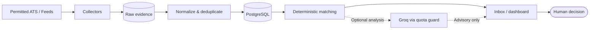
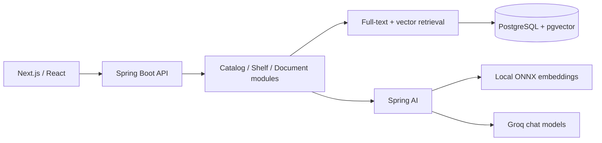

# Architecture gallery · implementation-oriented system diagrams

These diagrams reflect the linked repositories' published **current architecture** as of the review on 2026-11-12. They are simplified for readability, not service-topology screenshots. Planned items are excluded.

## 01 · Opportunity Radar

**System:** local-first Python modular monolith with a FastAPI API, APScheduler worker, PostgreSQL and React UI. Groq analysis is opt-in and never changes a deterministic match verdict. It is **not** an Ollama/embedding-search deployment.



**Boundary:** source evidence and decision rules are durable system records. AI is advisory, with quotas, schema validation and model-failure handling. [Reference](https://github.com/mathfrancisco/Opportunity-Radar/blob/main/docs/47-arquitetura-atual.md).

## 02 · AI Library Platform

**System:** Java 21 modular monolith and Next.js frontend. Backend owns catalog normalization, shelf, permissions and AI-enabled search/document workflows.



**Boundary:** owner-filtered private document retrieval. The app's weighted reciprocal-rank fusion combines lexical and vector results. Local ONNX embeddings and Groq chat are distinct components; V2/V3 roadmap items are not presented as shipped. [Reference](https://github.com/mathfrancisco/ai-library-plataform-mvp/blob/main/docs/02-architecture.md).

## 03 · Personal RAG Assistant

**System:** Python / LangChain pipeline, ChromaDB vector storage, Ollama by default and optional Gemini fallback, with Streamlit and CLI interfaces.

```mermaid
flowchart LR
  A[PDF / DOCX / TXT / Markdown] --> B[Load & parse]
  B --> C[Chunk + hash]
  C --> D[Local embeddings]
  D --> E[(ChromaDB)]
  F[Question] --> G[Retrieve top-k]
  E --> G
  G --> H[Grounded prompt]
  H --> I[Ollama / optional Gemini]
  I --> J[Answer + citations]
  G -. Evaluation harness .-> K[Recall@k / latency reports]
```

**Boundary:** citations expose evidence locations but are not automatic correctness guarantees. The evaluation tooling exists; published placeholder tables should never be interpreted as empirical results. Hybrid search, reranking and pgvector migration are roadmap items, not current features. [Reference](https://github.com/mathfrancisco/Personal-RAG-Assistant/blob/main/README.en.md).

---

All three diagrams use GitHub-native Mermaid code fences, hosted in this secondary document so the main profile README can render quickly. The main profile also includes a pre-rendered static SVG for Opportunity Radar.
